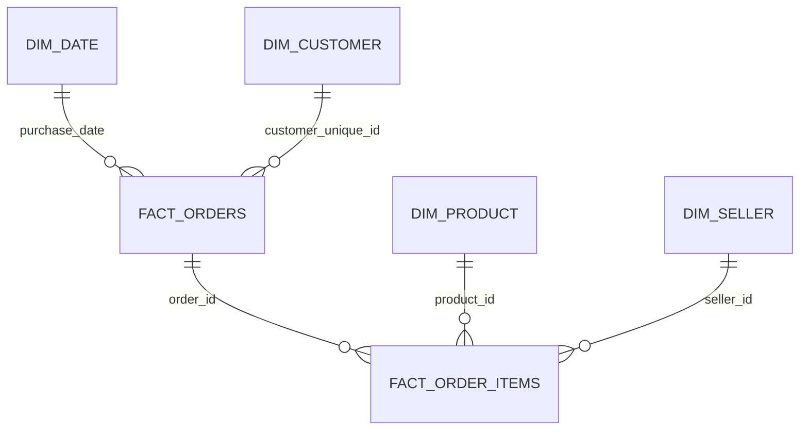
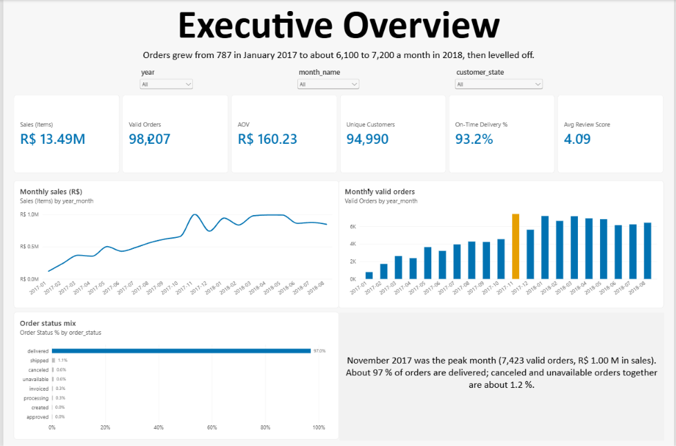
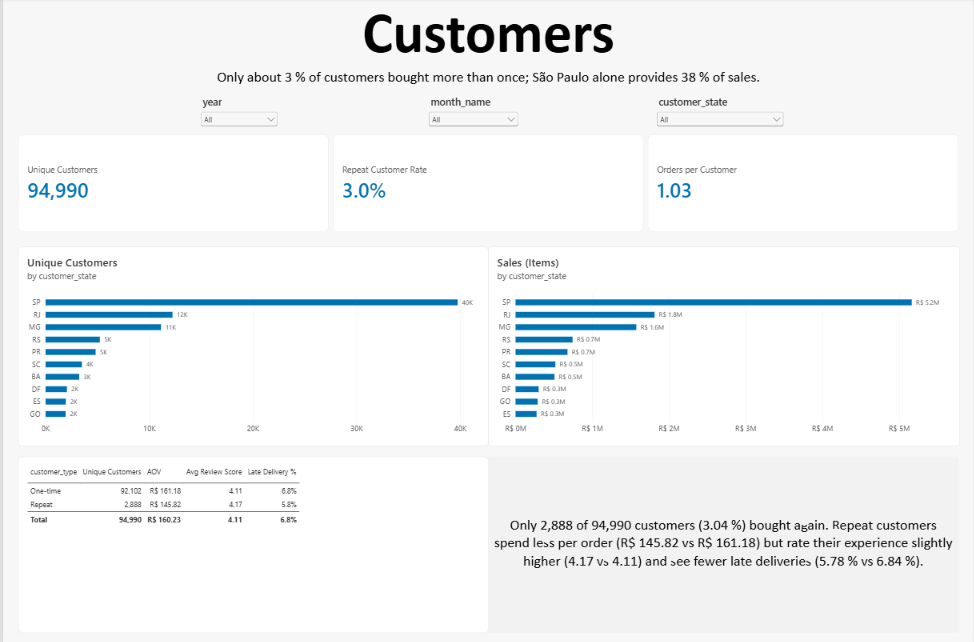
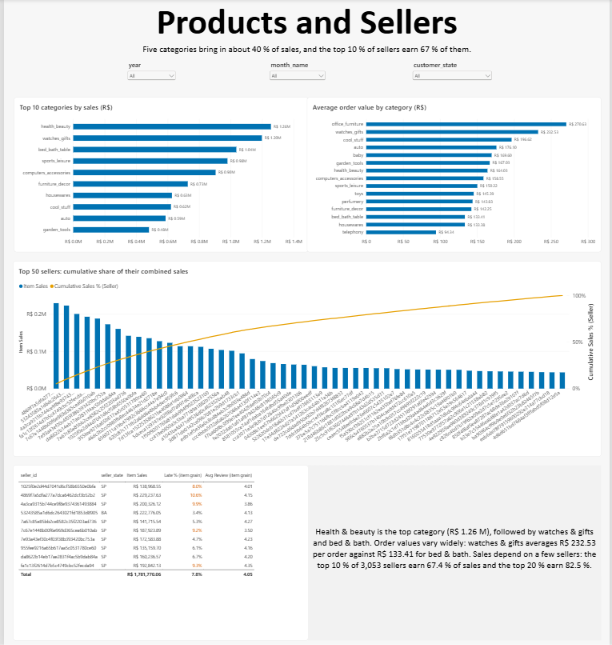
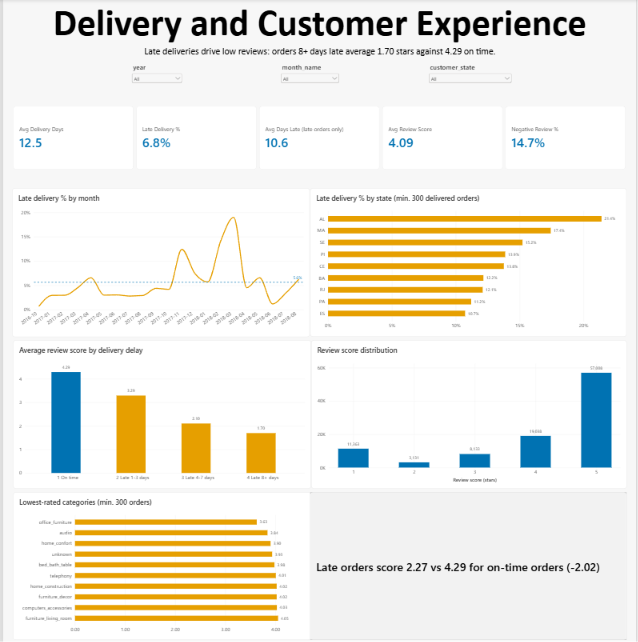

<h1 align="center">Olist E-Commerce Dashboard</h1>

<p align="center"><b>End-to-end business intelligence: from raw marketplace data to a decision-ready dashboard</b></p>

<p align="center">
  
  
  
  
  
</p>

<p align="center">
  Analytics Solutions Bootcamp &middot; Module 04 &middot; Take-Home Case Study 4 (Business Intelligence)<br>
  Author: Brent Nicole C. Cardano
</p>

> **Data source.** *Brazilian E-Commerce Public Dataset by Olist*, published on Kaggle: <https://www.kaggle.com/datasets/olistbr/brazilian-ecommerce>. All credit for the data belongs to Olist and Kaggle.

  ```mermaid
  flowchart TD
      A[("Raw Olist CSV files")] -->|docker compose| B[("PostgreSQL, schema kaggle")]
      B -->|SQL| C["Staging and order-grain aggregates"]
      C --> D["Semantic model: 2 facts + 4 dimensions"]
      D -->|Import| E["Power BI model and DAX"]
      E --> F["4-page dashboard"]
      F --> G["Insights and recommendations"]
  ```

---

## At a glance

| Valid orders | Unique customers | Sales (items) | Avg order value | Late deliveries | Avg delivery time | Avg review |
|:---:|:---:|:---:|:---:|:---:|:---:|:---:|
| **98,207** | **94,990** | **R$ 13.49 M** | **R$ 160.23** | **6.77 %** | **12.5 days** | **4.09 / 5** |

<sub>Sales exclude freight; average order value includes freight. Delivery figures use the 96,470 delivered orders that have a delivered date. Average review covers all 98,673 reviewed orders. Data spans September 2016 to October 2018; trends use the complete months January 2017 to August 2018 (see section 13).</sub>

### What the data says

| | Finding | Key number |
|:---:|---|---|
| 1 | **Late delivery is the clearest controllable problem.** The later an order arrives, the lower its review. | 4.29 stars on time vs **1.70** when 8+ days late |
| 2 | **Delays cluster by region and period.** Northeastern states and the peak-demand months suffer most. | AL **21.41 %** late vs 6.77 % average; March 2018 **18.96 %** |
| 3 | **The business is concentrated and mostly one-time.** | SP **38 %** of sales, top 10 % of sellers **67 %**, only **3 %** of customers repeat |

---

## Contents
1. [Business problem](#1-business-problem)
2. [Analytics objectives](#2-analytics-objectives)
3. [Data sources](#3-data-sources)
4. [Technology stack](#4-technology-stack)
5. [Repository structure and how to reproduce](#5-repository-structure-and-how-to-reproduce)
6. [Data preparation](#6-data-preparation)
7. [Semantic model](#7-semantic-model)
8. [Key business metrics](#8-key-business-metrics)
9. [Dashboard overview](#9-dashboard-overview)
10. [Business insights](#10-business-insights)
11. [Recommendations](#11-recommendations)
12. [Solution questions](#12-solution-questions)
13. [Assumptions and limitations](#13-assumptions-and-limitations)

---

## 1. Business problem
Olist is a Brazilian marketplace that connects small sellers to online customers. Management holds transactional data for roughly 100,000 orders (2016 to 2018) but has no consolidated view of it.

The dashboard must let management monitor **sales performance, customer behaviour, product and seller performance, and order fulfilment**, and show where the business can improve.

## 2. Analytics objectives
1. Profile the Olist tables and validate keys, relationships and grain.
2. Clean and type the data, and derive order, delivery and customer fields.
3. Build an analytics-ready semantic model that never duplicates measures across tables of different grain.
4. Define consistent business metrics (KPIs).
5. Run descriptive analysis (what happened) and diagnostic analysis (why: delivery delays and review scores).
6. Deliver an interactive dashboard for management, with insights and evidence-based recommendations.

## 3. Data sources
Nine Olist tables, loaded with `docker compose` into PostgreSQL (`localhost:5432`, database `asb_oltp`, schema `kaggle`). The course setup also provides a DuckDB copy.

| Table | Used | Purpose |
|---|:---:|---|
| `olist_orders_dataset` | Yes | Order status and timestamps (order grain) |
| `olist_order_items_dataset` | Yes | Price, freight, product and seller (item grain) |
| `olist_order_payments_dataset` | Yes | Payment value and type, aggregated to order grain |
| `olist_order_reviews_dataset` | Yes | Review score, latest review per order |
| `olist_customers_dataset` | Yes | Customer location; `customer_unique_id` identifies the person |
| `olist_products_dataset` + `product_category_name_translation` | Yes | Product category in English |
| `olist_sellers_dataset` | Yes | Seller location |
| `olist_geolocation_dataset` | No | Not needed: state and city from the customer and seller tables answer every question asked |

## 4. Technology stack
| Layer | Tool |
|---|---|
| Storage and transformation | PostgreSQL in Docker Compose (the SQL also runs on DuckDB) |
| Data preparation and validation | SQL (`sql/` folder) |
| Dashboard and measures | Power BI Desktop and DAX |
| Optional export | Python and `duckdb` (`scripts/`), for Tableau or Excel users |
| Version control | Git and GitHub |

## 5. Repository structure and how to reproduce
```text
sql/00_profile.sql                    data profiling and key validation
sql/01_semantic_model.sql             builds the semantic model (schema "semantic")
sql/02_validation_and_insights.sql    reconciliation and the numbers behind the insights
dax/measures.dax                      every dashboard measure
dashboard/                            Power BI file and theme.json
screenshots/                          exported dashboard pages
docs/dashboard_build_guide.md         page-by-page build specification
docs/validation_output.txt            saved output of sql/02 (evidence for every figure)
scripts/export_semantic_to_csv.py     optional export for Tableau or Excel
```

<details>
<summary><b>How to reproduce</b> (credentials come from a local <code>.env</code> file; none are stored in this repository)</summary>

```bash
# 1. In the course repository: start the database and load the raw tables
docker compose up -d asb-setup

# 2. In this repository: profile, build the semantic model, validate
psql -h localhost -p 5432 -U <user> -d asb_oltp -f sql/00_profile.sql
psql -h localhost -p 5432 -U <user> -d asb_oltp -f sql/01_semantic_model.sql
psql -h localhost -p 5432 -U <user> -d asb_oltp -f sql/02_validation_and_insights.sql
```

`01_semantic_model.sql` drops and rebuilds the `semantic` schema each time it runs, so it can be re-run safely.
</details>

## 6. Data preparation
| Step | What was done |
|---|---|
| Profiling | `00_profile.sql` checks row counts, duplicate keys, orphan records, nulls, date logic and grain traps |
| Types | Timestamps cast explicitly; empty strings become NULL |
| Category names | Translated to English; two untranslated categories keep the Portuguese name; missing categories become `unknown` |
| Derived fields | Order year and month, `order_value` (items plus freight), `delivery_days`, `estimated_days`, `delay_days`, `is_late`, `delay_bucket`, `customer_type`, `review_group` |
| De-duplication | Reviews: latest review per order. Payments and items: aggregated to order grain before any join |
| Physical tables | The semantic model is stored as tables (not views), which keeps queries and Power BI refreshes fast |

**Source row counts:** 99,441 orders, 112,650 order items, 103,886 payment rows, 99,224 reviews, 99,441 customer ids, 32,951 products and 3,095 sellers. **Every key relationship is clean:** no orphan items, payments, reviews, orders or customers, and no duplicate order, product, seller or customer keys.

> [!IMPORTANT]
> **Reconciliation passed.** Part A of `sql/02_validation_and_insights.sql` compares the semantic model with the raw tables. Orders (99,441), items (112,650), sum of item prices (R$ 13,591,643.70), sum of payments (R$ 16,008,872.12), orders with a review (98,673) and orders with items (98,666) all match exactly.
>
> The R$ 13.59 M above covers **all** orders. The dashboard's **Sales (Items)** KPI counts **valid orders only** (excluding canceled and unavailable), which is **R$ 13,494,400.74**.

<details>
<summary><b>Data-quality findings and decisions</b> (12 checks)</summary>

| Issue | Count | Decision |
|---|---:|---|
| Orders with more than one item (item grain is not order grain) | 9,803 | Items aggregated to order grain in `agg_order_items`; a separate item-grain table serves category and seller analysis |
| Orders with more than one payment record | 2,961 | Payments summed per order in `agg_order_payments` before joining |
| Orders with more than one review | 547 | Latest review kept per order in `agg_order_reviews` |
| Duplicate `review_id` values | 789 | Resolved by the same one-review-per-order rule |
| Orders without any item | 775 | No sales value; kept with zero value and excluded from sales and average order value |
| Delivered orders with a missing delivered date | 8 | Excluded from delivery-time and late-rate metrics |
| Non-delivered orders that have a delivered date | 6 | Date ignored; delivery metrics use `delivered` orders only |
| Payments with a value of 0 or less | 9 | Kept (immaterial); sales use item prices, not payments |
| Products without a category | 610 | Shown as `unknown` |
| Categories without an English translation | 2 | Fall back to the Portuguese name |
| Payment total differs from item plus freight total | 0.25 % of orders | Documented (vouchers, rounding); sales use item and freight values |
| Partial months at the edges of the data | 2016-09 to 2016-12 and 2018-09 to 2018-10 | Trends read only for complete months, January 2017 to August 2018 |

**Order status mix:** delivered 97.02 % (96,478 orders), shipped 1.11 %, canceled 0.63 %, unavailable 0.61 %, invoiced 0.32 %, processing 0.30 %, created and approved under 0.01 % each.
</details>

## 7. Semantic model
A star-style model with two fact tables of **different grain**, stored in the `semantic` schema.



| Table | Grain | Role |
|---|---|---|
| `fact_orders` | 1 row per order | Order value, delivery, review and payment |
| `fact_order_items` | 1 row per order item | Sales by product category and seller |
| `dim_customer` | 1 row per `customer_unique_id` | Location, order counts, one-time or repeat |
| `dim_product` | 1 row per product | English category |
| `dim_seller` | 1 row per seller | Seller city and state |
| `dim_date` | 1 row per calendar date | Calendar attributes |

All relationships are one-to-many with a single filter direction. The intermediate tables `stg_orders`, `agg_order_items`, `agg_order_payments` and `agg_order_reviews` hold the order-grain preparation steps and are not loaded into the dashboard.

### Key modelling decisions
1. **Child tables are reduced to one row per order before joining.** Joining items, payments and reviews directly would multiply each order's value by the number of rows in the other tables.
2. **`customer_unique_id` is the customer.** `customer_id` is created per order, so using it would make nearly every customer look like a one-time buyer.
3. **Repeat customer** means two or more valid orders (status not `canceled` or `unavailable`).
4. **Sales** are item prices excluding freight, on valid orders. **Order value** is price plus freight.
5. **Delivery metrics** use `delivered` orders that have a delivered date. A positive `delay_days` means the order arrived after the estimated date.
6. **Item-grain diagnostics** carry order-level fields (review, late flag) with `order_weight = 1 / items in the order`, so category and seller averages count each order once.

## 8. Key business metrics
| Metric | Definition |
|---|---|
| Sales (Items) | Sum of item price on valid orders |
| Valid Orders | Orders not `canceled` or `unavailable` |
| Average Order Value (AOV) | (Sales plus freight) divided by valid orders |
| Unique Customers | Distinct `customer_unique_id` with a valid order |
| Repeat Customer Rate | Repeat customers divided by unique customers |
| Avg Delivery Days | Mean days from purchase to delivery (delivered orders) |
| Late Delivery % | Orders delivered after the estimated date, divided by delivered orders |
| Avg Review Score | Mean of the latest review per order |
| Negative Review % | Orders scored 1 or 2, divided by reviewed orders |

All measures are written in `dax/measures.dax`, and the same logic is checked in SQL in `sql/02_validation_and_insights.sql`.

## 9. Dashboard overview
Four pages share the same layout (top-rail, Z-pattern reading order: KPIs first, trends next, diagnostics last), the same filters and the same colours.

| Page | Business questions | Main visuals |
|---|---|---|
| **1. Executive overview** | 5.1.1 to 5.1.5 | KPI cards, monthly sales and orders, order status mix |
| **2. Customers** | 5.2.1 to 5.2.4 | State ranking and map, top states, repeat vs one-time customers |
| **3. Products and sellers** | 5.3.1 to 5.3.4 | Top categories, average order value by category, seller Pareto, top-seller table |
| **4. Delivery and experience** | 5.4.1 to 5.4.4 and 5.5.1 to 5.5.4 | Late % by month and state, review score by delay bucket, review distribution, lowest-rated categories |

**Design principles applied**

| Principle | How it is applied |
|---|---|
| Colour-blind-safe palette | Blue `#0072B2` for the main series, orange `#D55E00` for problems (late, low reviews), amber `#E69F00` for secondary highlights, grey `#BDBDBD` for de-emphasis; no red-green pairs |
| Proportional ink | Bar charts start at zero; no truncated axes |
| One highlight per visual | Everything grey or blue except the item the story is about |
| Consistent filters | Year, month and state filters in the same position and synced across pages |
| Question-driven visuals | Each visual answers a stated business question; no decorative charts |

The dashboard file is `dashboard/olist_dashboard.pbix`.

<!--
After you add your screenshots to the screenshots/ folder, delete these comment markers and keep the lines below.





-->

## 10. Business insights
Every figure below comes from `sql/02_validation_and_insights.sql` (saved in `docs/validation_output.txt`) and is reproduced in the dashboard. Figures marked **≈** are derived by multiplying two reported numbers. Each insight states what was observed, the evidence, and why it matters.

### Insight 1: Late delivery is strongly associated with poor reviews
**Observation.** Orders delivered after the estimated date receive much lower scores, and the score falls further the longer the delay.

| Delivery | Orders | Avg review (of 5) | | Negative reviews (1 to 2 stars) | |
|---|---:|---:|---|---:|---|
| On time | 89,443 | 4.29 | `█████████████████░░░` | 9.27 % | `██░░░░░░░░░░░░░░░░░░` |
| Late 1 to 3 days | 1,852 | 3.29 | `█████████████░░░░░░░` | 32.13 % | `██████░░░░░░░░░░░░░░` |
| Late 4 to 7 days | 1,748 | 2.10 | `████████░░░░░░░░░░░░` | 67.68 % | `██████████████░░░░░░` |
| Late 8+ days | 2,781 | 1.70 | `███████░░░░░░░░░░░░░` | 79.29 % | `████████████████░░░░` |


All late orders combined average **2.27 stars** and **62.4 %** negative reviews. An order 8 or more days late is about **8.6 times** as likely to receive a negative review as an on-time order. The correlation between delivery days and review score is **-0.334**.

For context, the overall review distribution (98,673 reviewed orders; full bar width = 60 %):

| Stars | Orders | Share | |
|:---:|---:|---:|---|
| 1 ★ | 11,363 | 11.52 % | `████░░░░░░░░░░░░░░░░` |
| 2 ★ | 3,131 | 3.17 % | `█░░░░░░░░░░░░░░░░░░░` |
| 3 ★ | 8,133 | 8.24 % | `███░░░░░░░░░░░░░░░░░` |
| 4 ★ | 19,038 | 19.29 % | `██████░░░░░░░░░░░░░░` |
| 5 ★ | 57,008 | 57.77 % | `███████████████████░` |


**Why it matters.** Fulfilment, not the product, is a controllable driver of customer satisfaction.

### Insight 2: Late deliveries cluster in specific regions and periods
**Observation.** The late rate is far from uniform across states and months, and rate alone does not show where most late orders happen.

**Evidence.** The overall late rate is **6.77 %** of 96,470 delivered orders (average delivery 12.5 days against an estimate of 24.4 days). The ten states with the highest late rate (at least 300 delivered orders):

| State | Delivered orders | Late rate | | Avg delivery days | Late orders (≈) | |
|---|---:|---:|---|---:|---:|---|
| AL | 397 | 21.41 % | `█████████████████░░░` | 24.5 | 85 | `█░░░░░░░░░░░░░░░░░░░` |
| MA | 717 | 17.43 % | `██████████████░░░░░░` | 21.5 | 125 | `██░░░░░░░░░░░░░░░░░░` |
| SE | 335 | 15.22 % | `████████████░░░░░░░░` | 21.5 | 51 | `█░░░░░░░░░░░░░░░░░░░` |
| PI | 476 | 13.87 % | `███████████░░░░░░░░░` | 19.4 | 66 | `█░░░░░░░░░░░░░░░░░░░` |
| CE | 1,279 | 13.76 % | `███████████░░░░░░░░░` | 21.2 | 176 | `██░░░░░░░░░░░░░░░░░░` |
| BA | 3,256 | 12.16 % | `██████████░░░░░░░░░░` | 19.3 | 396 | `█████░░░░░░░░░░░░░░░` |
| RJ | 12,350 | 12.11 % | `██████████░░░░░░░░░░` | 15.2 | 1,496 | `████████████████████` |
| PA | 946 | 11.21 % | `█████████░░░░░░░░░░░` | 23.7 | 106 | `█░░░░░░░░░░░░░░░░░░░` |
| ES | 1,995 | 10.73 % | `█████████░░░░░░░░░░░` | 15.7 | 214 | `███░░░░░░░░░░░░░░░░░` |
| PB | 517 | 10.44 % | `████████░░░░░░░░░░░░` | 20.4 | 54 | `█░░░░░░░░░░░░░░░░░░░` |
| *Marketplace* | *96,470* | *6.77 %* | `█████░░░░░░░░░░░░░░░` | *12.5* | | |


<sub>Late orders (≈) = delivered orders × late rate. Rate bar: full width = 25 %. Volume bar: full width = 1,500 late orders.</sub>

- **By rate,** the northeastern states lead: Alagoas (AL) is late three times as often as the marketplace average.
- **By volume,** the picture changes. AL, MA and SE together account for roughly 260 late orders, while **Rio de Janeiro (RJ) alone has about 1,500**, because it is a much larger market with a late rate still almost twice the average.
- **By month,** the worst were **March 2018 (18.96 %)**, **February 2018 (14.13 %)** and **November 2017 (12.40 %)**, against 1.16 % in June 2018.
- **By category,** the highest late rates are audio (11.88 %), home_confort (9.83 %), baby (8.15 %) and office_furniture (8.11 %).

<details>
<summary><b>Monthly orders, late rate and delivery time (January 2017 to August 2018)</b></summary>

| Month | Valid orders | | Late rate | | Avg delivery days |
|---|---:|---|---:|---|---:|
| 2017-01 | 787 | `██░░░░░░░░░░░░░░░░░░` | 2.93 % | `███░░░░░░░░░░░░░░░░░` | 12.8 |
| 2017-02 | 1,718 | `█████░░░░░░░░░░░░░░░` | 2.96 % | `███░░░░░░░░░░░░░░░░░` | 13.3 |
| 2017-03 | 2,617 | `███████░░░░░░░░░░░░░` | 4.56 % | `█████░░░░░░░░░░░░░░░` | 13.0 |
| 2017-04 | 2,377 | `██████░░░░░░░░░░░░░░` | 6.56 % | `███████░░░░░░░░░░░░░` | 15.0 |
| 2017-05 | 3,640 | `██████████░░░░░░░░░░` | 2.99 % | `███░░░░░░░░░░░░░░░░░` | 11.4 |
| 2017-06 | 3,205 | `█████████░░░░░░░░░░░` | 3.03 % | `███░░░░░░░░░░░░░░░░░` | 12.0 |
| 2017-07 | 3,946 | `███████████░░░░░░░░░` | 2.79 % | `███░░░░░░░░░░░░░░░░░` | 11.5 |
| 2017-08 | 4,272 | `███████████░░░░░░░░░` | 2.91 % | `███░░░░░░░░░░░░░░░░░` | 11.0 |
| 2017-09 | 4,227 | `███████████░░░░░░░░░` | 4.39 % | `████░░░░░░░░░░░░░░░░` | 11.7 |
| 2017-10 | 4,547 | `████████████░░░░░░░░` | 4.18 % | `████░░░░░░░░░░░░░░░░` | 11.7 |
| 2017-11 | 7,423 | `████████████████████` | 12.40 % | `████████████░░░░░░░░` | 15.1 |
| 2017-12 | 5,620 | `███████████████░░░░░` | 7.46 % | `███████░░░░░░░░░░░░░` | 15.3 |
| 2018-01 | 7,187 | `███████████████████░` | 5.70 % | `██████░░░░░░░░░░░░░░` | 14.0 |
| 2018-02 | 6,625 | `██████████████████░░` | 14.13 % | `██████████████░░░░░░` | 16.9 |
| 2018-03 | 7,168 | `███████████████████░` | 18.96 % | `███████████████████░` | 16.2 |
| 2018-04 | 6,919 | `██████████████████░░` | 4.50 % | `████░░░░░░░░░░░░░░░░` | 11.4 |
| 2018-05 | 6,833 | `██████████████████░░` | 6.56 % | `███████░░░░░░░░░░░░░` | 11.3 |
| 2018-06 | 6,145 | `████████████████░░░░` | 1.16 % | `█░░░░░░░░░░░░░░░░░░░` | 9.2 |
| 2018-07 | 6,233 | `█████████████████░░░` | 3.38 % | `███░░░░░░░░░░░░░░░░░` | 8.9 |
| 2018-08 | 6,421 | `█████████████████░░░` | 6.19 % | `██████░░░░░░░░░░░░░░` | 7.7 |


<sub>Order bar: full width = 7,500 valid orders. Late-rate bar: full width = 20 %.</sub>
</details>

**Why it matters.** The problem can be targeted by region, period and seller, by rate and by volume, instead of being fixed across the whole marketplace.

### Insight 3: Sales are concentrated in a few states, sellers and categories
**Observation.** A small share of sellers, categories and states produces most of the sales.

**Evidence.** The top 10 % of the 3,053 selling sellers earn **67.4 %** of sales and the top 20 % earn **82.5 %**. The top five categories (health_beauty, watches_gifts, bed_bath_table, sports_leisure, computers_accessories) account for **39.8 %**. Share of sales by state (full bar width = 40 %):

| State | Share of sales | |
|---|---:|---|
| SP | 38.27 % | `███████████████████░` |
| RJ | 13.43 % | `███████░░░░░░░░░░░░░` |
| MG | 11.66 % | `██████░░░░░░░░░░░░░░` |
| RS | 5.50 % | `███░░░░░░░░░░░░░░░░░` |
| PR | 5.02 % | `███░░░░░░░░░░░░░░░░░` |


Average order value also differs by category. Among the 15 categories with the highest sales, **office_furniture is highest (R$ 270.63)** followed by watches_gifts (R$ 232.53), and **telephony is lowest (R$ 94.34)**.

**Why it matters.** Concentration is a risk, and it gives a short list of sellers, categories and regions where service quality has the most effect on revenue.

### Insight 4: Very few customers come back
**Observation.** Most customers buy only once.

**Evidence.** Only **2,888 of 94,990** customers with a valid order (**3.04 %**) bought again, averaging 2.11 orders each. Repeat customers spend less per order (R$ 145.82 vs R$ 161.18), rate their experience slightly higher (4.18 vs 4.11) and see fewer late deliveries (5.78 % vs 6.84 %).

**Why it matters.** Growth depends almost entirely on winning new customers, so retention is an under-used lever.

### Insight 5: Strong growth through 2017, then a plateau
**Observation.** Monthly volume grew quickly, peaked in November 2017 and then levelled off.

**Evidence.** Valid orders rose from 787 in January 2017 to 7,187 in January 2018. The peak month is **November 2017** (7,423 valid orders, R$ 1.00 M in sales), most likely a Black Friday effect (an interpretation that was not tested). From December 2017 to August 2018, monthly orders stay between about 5,600 and 7,200 (6,421 in August 2018). Delivery performance was weakest in the high-volume months of November 2017, February 2018 and March 2018.

**Why it matters.** Volume is no longer growing at the 2017 pace, which supports the focus on retention and service quality, and the late-delivery pattern may point to capacity strain in peak periods (an interpretation that was not tested).

### Other factors linked to review scores
| Factor | Result | Reading |
|---|---|---|
| Items in the order | 4.16 (1 item), 3.65 (2 items), 3.43 (3+ items) | Multi-item orders score lower; the data cannot confirm why |
| Freight share of order value | 4.14 (under 10 %) to 4.03 (40 % or more) | Small association |
| Payment type | Credit card and boleto 4.09, voucher 4.00, debit card 4.17 | Little difference |
| Lowest-rated categories (300+ items) | office_furniture 3.63, audio 3.84, home_confort 3.90 | Also among the categories with the highest late rates |
| Lowest-rated sellers (50+ items) | 2.33 to 3.26 stars, late rates from 5.7 % to 30.5 % | Seller quality matters beyond lateness alone |

## 11. Recommendations
1. **Cut late deliveries by rate and by volume.** Review delivery performance in the highest-rate states (AL, MA, SE) and, because of its volume, in RJ and other large markets. Set seller-level delivery commitments and make estimated delivery dates more realistic where the gap between estimate and actual is widest. *Target: move the late rate of AL (21.41 %), MA (17.43 %) and SE (15.22 %) towards the 6.77 % average, and cut RJ's 12.11 % in half. Based on Insights 1 and 2.*
2. **Add a recovery step for orders that become late.** Send a proactive notice and tracking update, and offer a voucher on delays of 8 days or more, because the review penalty grows with the size of the delay (4.29 on time, 1.70 at 8+ days late). *Based on Insight 1.*
3. **Put a quality watchlist on the weakest categories and sellers.** office_furniture, audio and home_confort combine low review scores with high late rates, and the lowest-rated sellers average 2.33 to 3.26 stars. Because the top 10 % of sellers earn 67.4 % of sales, monitor the largest sellers first. *Based on Insights 2 and 3 and the table of other factors.*
4. **Pilot a retention programme and measure it.** Offer follow-up promotions after the first delivered order, but send customers whose first order was late or poorly rated a service-recovery message first. Track the repeat rate (3.04 % today) as the pilot's success measure. *Based on Insights 1 and 4. The link between a late first order and a lower repeat rate has not been tested in this analysis and should be the first thing the pilot measures.*

## 12. Solution questions

**1. What are the most important KPIs, and why?**
Sales (Items), Valid Orders and AOV show size and value. Unique Customers and Repeat Customer Rate show growth and loyalty. Late Delivery %, On-Time Delivery % and Avg Delivery Days show fulfilment quality. Avg Review Score and Negative Review % show customer satisfaction. Together they cover the four areas management asked to monitor and connect operations (delivery) to outcomes (reviews).

**2. How were datasets of different grain combined without duplicating measures?**
Items, payments and reviews each have several rows per order, so each is reduced to **one row per order** before joining to `fact_orders`. Sales by category and seller use a separate item-grain table. Order-level fields carried onto items (review, late flag) are averaged with `order_weight = 1 / items in the order`, and order-level amounts are never summed from the item table. `sql/02_validation_and_insights.sql` reconciles row counts and totals against the raw tables, and all checks match.

**3. What are the most important trends or patterns?**
Reviews depend heavily on delivery: the average score is 4.29 for on-time orders but 1.70 for orders 8 or more days late. Late deliveries concentrate in northeastern states by rate (AL 21.41 %, MA 17.43 %), in high-volume states by count (RJ about 1,500 late orders), and in certain months (March 2018: 18.96 %), against a marketplace average of 6.77 %. The business is concentrated and mostly one-time: SP provides 38.27 % of sales, the top 10 % of sellers provide 67.4 %, and only 3.04 % of customers bought again.

**4. What factors contribute to poor delivery performance or low reviews?**
*Delivery.* The northeastern states (AL, MA, SE, PI, CE) have the highest late rates and the longest delivery times. March 2018, February 2018 and November 2017 were the worst months, and audio and home_confort are the categories with the highest late rates.
*Reviews.* Lateness and the size of the delay are the strongest pattern (4.29 on time; 3.29, 2.10 and 1.70 for 1 to 3, 4 to 7 and 8+ days late; correlation of delivery days with review score -0.334). Orders with several items score lower (4.16 for one item, 3.43 for three or more), and the lowest-rated categories and sellers are listed in section 10. Freight share and payment type matter little. These are associations in observational data, not proof of cause.

**5. What business actions are recommended?**
See [section 11](#11-recommendations).

## 13. Assumptions and limitations
- **Period.** Dates run from 2016 to 2018. The first and last months are partial, so trends are read only over complete months (January 2017 to August 2018).
- **Definitions.** A valid order has a status other than `canceled` or `unavailable`. Sales exclude freight. The currency is the Brazilian real (BRL), not adjusted for inflation.
- **Reviews.** Only the latest review per order is used. Reviews are voluntary, so scores can lean towards very happy and very unhappy customers.
- **Repeat customers.** Identified by `customer_unique_id`; a customer who changes identity would be missed. Repeat status uses all orders in the data window.
- **Delivery.** Metrics use `delivered` orders that have a delivered date. An order is late when delivered after the estimated date (calendar-day comparison).
- **Payments.** Payment totals can differ from item plus freight totals (vouchers, rounding); sales and AOV use item and freight values.
- **Derived figures.** Late-order counts by state (≈) are delivered orders multiplied by the late rate, so they are rounded estimates; only the ten highest-rate states were ranked.
- **Carriers.** The dataset has no carrier field, so carrier performance cannot be measured here; reviewing carriers is an action for the business, not a finding.
- **Scope.** The data is anonymised and covers one marketplace. Findings are associations, not causal effects.

---

<p align="center"><sub>Dataset: Olist and Kaggle, <a href="https://www.kaggle.com/datasets/olistbr/brazilian-ecommerce">brazilian-ecommerce</a>. Prepared as part of the Analytics Solutions Bootcamp.</sub></p>
